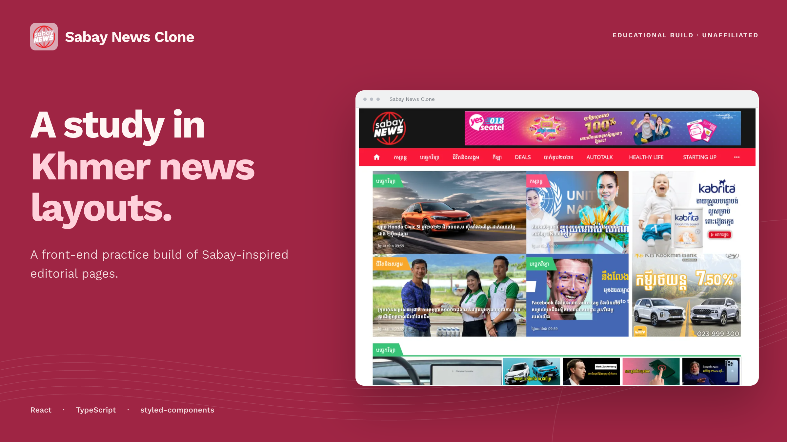
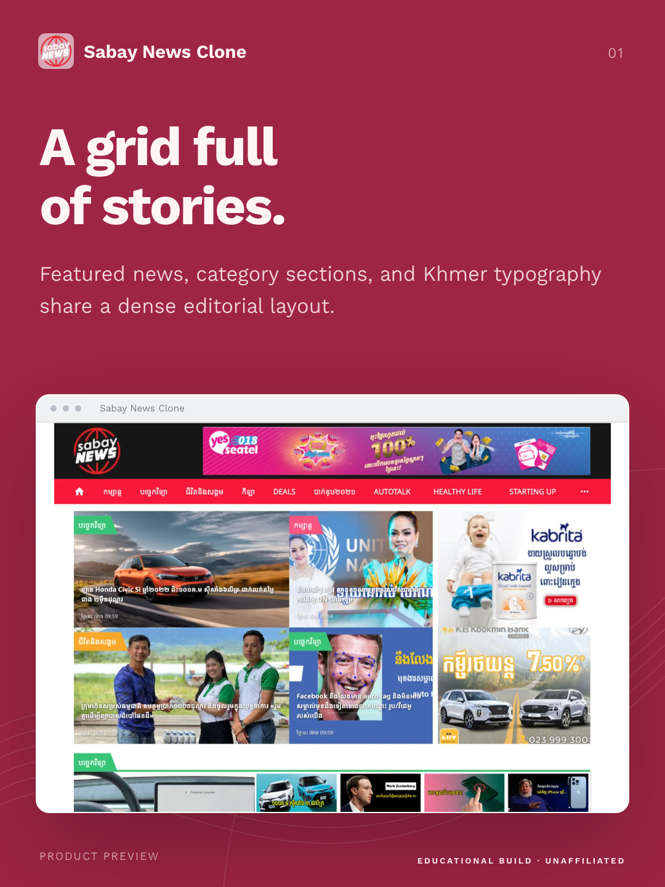
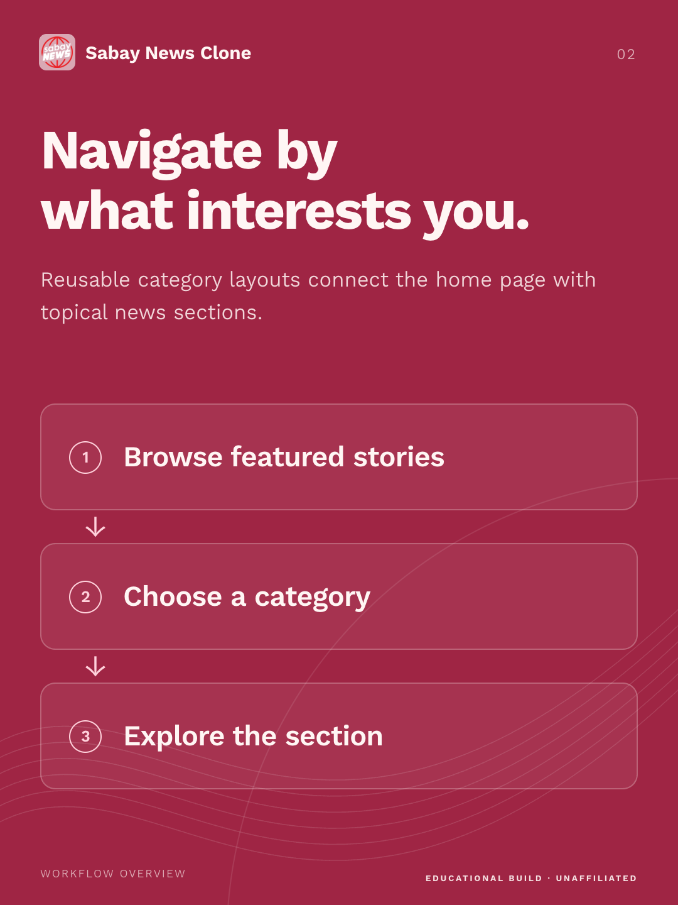
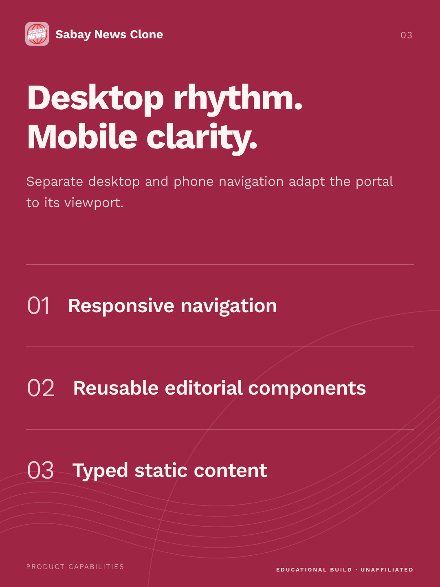

<div align="center">

# React Sabay News Clone

**A responsive clone of the Sabay News website UI.**


</div>

<!-- product-images:start -->

## Product preview

<p align="center">
  
</p>

<table>
<tr>
  <td width="33%"></td>
  <td width="33%"></td>
  <td width="33%"></td>
</tr>
</table>

<!-- product-images:end -->

---

## Overview

React Sabay News Clone recreates the layout of [Sabay News](https://news.sabay.com.kh/), one of Cambodia's popular news portals, as a front-end practice project. It includes the home page, category pages, featured stories, and separate desktop and mobile navigation.

> This is an educational UI clone and is not affiliated with Sabay.

## Features

- **Home page** with featured stories and category sections.
- **Category pages:** Technology, Entertainment, Sport, Healthy Life, Life & Society, Auto Talk, Starting Up, Deals, BacII, Quiz, and Covid-19.
- **Responsive navigation** with dedicated desktop and phone navbars.
- **Reusable components** for badges, categories, details, features, and the footer.
- **Typed static data** for content, ads, and the footer.

## Tech Stack

| Area     | Technology                       |
| -------- | -------------------------------- |
| UI       | React 18, React Router 6         |
| Language | TypeScript                       |
| Styling  | Styled Components, MUI (Emotion) |
| Build    | Create React App                 |

## Getting Started

### Prerequisites

- Node.js and npm

### Installation

```bash
git clone https://github.com/RithyBondeth/React-SabayNews-Clone.git
cd React-SabayNews-Clone
npm install
npm start
```

Open [http://localhost:3000](http://localhost:3000).

### Scripts

| Command         | Description                  |
| --------------- | ---------------------------- |
| `npm start`     | Start the development server |
| `npm run build` | Create a production build    |
| `npm test`      | Run tests                    |

## Project Structure

```text
React-SabayNews-Clone/
└── src/
    ├── pages/        # Home and category pages
    ├── components/   # Navbar, phone navbar, feature, category, detail, footer
    ├── data/         # Content, category, ads, and footer data
    └── hooks/        # usePageTitle
```

## Author

**Rithy Bondeth** — Full Stack Developer & AI Engineer

[](https://bondeth.dev)
[](https://github.com/RithyBondeth)
[](https://www.linkedin.com/in/rithy-bondeth-484073282/)

## License

Distributed under the MIT License. See [`LICENSE`](LICENSE) for details. The license covers the source code only; Sabay names, logos, and images belong to their respective owners.
